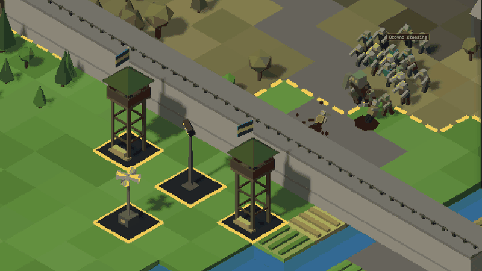
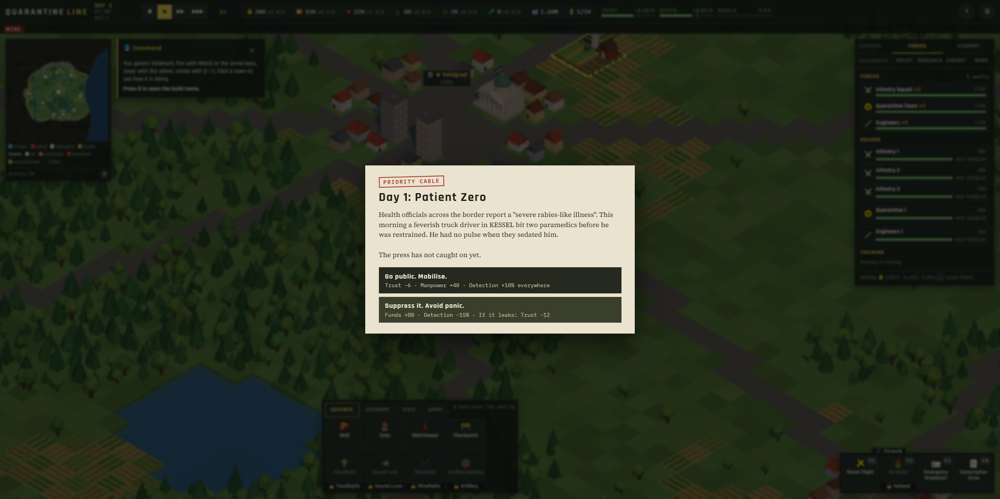
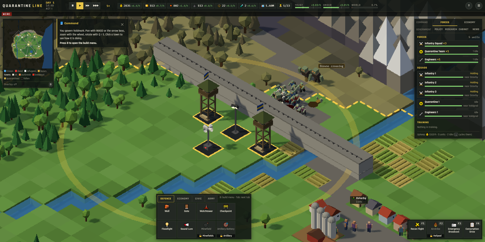

# Quarantine Line

A real-time strategy game for the browser. You are the government of a small country on the morning the
first infected case is found, and you have to hold the country together until Day 50.

**[Play it in your browser](https://cmullis1.github.io/quarantine-line/)** (mouse and keyboard, no install)



## What it does

You are not a general. You build walls and train squads, but the choices that decide the game are who
gets across the border, what the public is told, which towns are saved and which are given up, and how
much freedom you trade for order.

- **The border is a policy.** Refugees walk to your road crossings. Let them in and your population
  and workforce grow, but some of them carry the infection. Screen them at checkpoints, close the
  border and leave them stranded, or worse. Every stance has a cost you can see.
- **The infection hides.** Each town has a true case count and a reported one. Quarantine teams,
  field hospitals and testing raise what you can see; low public trust means people hide their sick.
  Left alone, an outbreak grows until the dead walk out into the streets.
- **The dead behave like a force of nature.** Hordes follow noise and route around gaps in your walls.
  Against a solid wall they pile up on each other until the top of the pile spills over. Runners,
  brutes, howlers and the drowned (who walk out of the sea) each break a different defensive habit.
- **Trust and Order.** Two meters measure whether people cooperate and whether they comply. Force buys
  order and spends trust. If either reaches zero, the government falls.
- **Hard calls.** Scripted decisions across four acts (cover up the first case or go public, approve an
  unproven vaccine, stage a televised battle) and a cabinet that asks for things with deadlines. The
  ending you get depends on the record you leave.

There is a 12-minute Basic Training mission that teaches every system, a 50-day campaign in the
fictional Republic of Valdmark, and an endless Sandbox on a randomly generated country, each at three
difficulties. Under the hood: about twenty buildings, eleven unit types, a research tree, laws, an
economy where producers need workers from the towns, weather, day and night, and a procedural music
score that follows the state of the war.





## How to run it

The easiest way is the [live version](https://cmullis1.github.io/quarantine-line/). The in-game Field
Manual (F10, or the `?` button) lists every control.

To run it locally you need Python 3 (any static file server works, but the page has to be served, not
opened as a file):

```
python serve.py
```

Then open http://localhost:28802. The game loads Three.js and its fonts from a CDN, so it needs an
internet connection.

There is no build step: it is plain JavaScript modules, HTML and CSS. The simulation in `js/sim/` has
no rendering or browser code, so it also runs under Node. With Node 22 or newer:

```
# the automated tests
npm test

# one bot game, printed day by day
node tools/headless.mjs --bot balanced --days 50 --difficulty veteran

# a balance matrix: bots x difficulties x seeds
node tools/balance.mjs --bots idle,balanced,turtle --diffs recruit,veteran --seeds 4
```

## How it works

The simulation in `js/sim/` is plain data and plain functions: no DOM, no Three.js. It advances in fixed steps of
0.05 game hours (a day is 36 real seconds at 1x) and reports what happened as a queue of events (shots, deaths,
climbs over a wall, alerts). Each frame the renderer, the sound engine and the HUD drain that queue; they read the
state but never change it. The player and the bots act only through one commands API (`js/sim/commands.js`),
which checks every request and turns a stale id or bad input into a refusal instead of an exception.

- **Deterministic and saveable.** All randomness comes from one seeded mulberry32 generator whose state is part
  of the game state; the weather is hashed from the seed and the day so it never shifts that stream. A save is the
  state as JSON in localStorage, and the map is rebuilt from the seed. Tests check that two runs with the same seed
  and commands end in identical state, and that a game saved in the middle of a horde and reloaded carries on
  exactly as if it had never stopped.
- **A horde that flows.** The dead do not pathfind one by one. Whenever a structure goes up or a town falls, the
  sim recomputes a multi-source Dijkstra flow field over the 144 x 144 tile grid toward every living town (bigger
  towns pull harder), and each of the dead follows the arrow on its tile. Structures are passable at a high cost,
  so the field leads the horde through a gap if there is one and otherwise straight to the wall to claw at it.
  Noise and living targets nearby pull individuals off the field. Squads and refugees use A* with cheaper roads;
  buses use a road-only A*.
- **Pile-ups.** Every step, each wall counts the dead pressing into it plus the stalled crowd behind them that is
  heading its way. When the count reaches the wall's threshold (higher for a High Wall), bodies from the top of
  the pile drop to the far side at a steady rate.
- **A pacing director.** The war runs in phases: build, peak, relax. A peak starts when a horde makes contact or
  enough of the dead are inside the border, and ends when the fight is over. Then comes a guaranteed calm (36
  game hours on Recruit, 20 on Veteran, 8 on Nightmare): no new horde starts, the stray trickle stops, stragglers
  nobody can see wander back, and story cards wait for it instead of landing mid-fight. A threat chip beside the
  clock shows the phase and the hours of calm left. `tools/pacing.mjs` measures the share of quiet hours per day.
- **Hidden infection.** Each town's true case count grows logistically. The reported count is the true count from
  some hours earlier times a detection rate built from laws, hospitals, hazmat teams nearby and public trust;
  censorship makes it later and noisier. Past a threshold the sick turn in the streets, and a fallen town keeps
  releasing the dead.
- **Generated countries.** The campaign map is hand-shaped. A Sandbox country is built from seeded value noise
  and fractal noise and re-rolled until it is fair: every town reachable from the capital, at least four border
  crossings, and a walkable route from every foreign city to its crossing.
- **Rendering.** Three.js r160 with an orthographic, true isometric camera. Every model is assembled from
  primitives at load time, and the scene is drawn at a fraction of screen resolution for a chunky low-res look.
  Each render pixel covers a whole number of physical pixels at the display's scaling, the pixel size shrinks as
  you zoom out (P cycles it), and the camera snaps to the render-pixel grid so scenery does not shimmer while
  panning. Towns, trees, walls and fields are batched, so a day view is about 70 draw calls. Soldiers, civilians, refugees and every kind of the dead share one InstancedMesh per
  body part, about a dozen draw calls for everyone on screen, so hundreds of the dead stay cheap. Tracers,
  particles and decals come from fixed pools. The game ships no image or audio files.
- **An adaptive score.** Every sound is synthesised with Web Audio. A music director made of pure functions plans
  the score one 8-bar phrase at a time: a song for each act, a mood (Hopeful in C major, Uneasy and Dire in A
  minor, each with its own tempo, groove, band and reverb) that follows how badly the war is going, and an
  intensity level that follows the danger on screen. A change of mood glides the tempo over one phrase and
  crossfades the bands on a shared chord, and the sequencer schedules each sixteenth just ahead of the audio clock
  so the grid bends without breaking. Open the game with `?musiclab` to pin any part of the score and hear it.

**Bots and balance.** The bots in `js/ai/bots.js` play through the same commands as the UI. Each has a
recognisable style (idle, balanced, turtle, hawk, dove) so a balance pass shows what the numbers reward. An expert
bot plays like the balanced one but watches its weakest meter and changes approach, and answers decision cards by
reading the costs printed on them. The expert seals the border with the cheapest possible wall line, found as a
minimum vertex cut (Dinic's max flow) between foreign land and the living towns, and replans it when a wall falls.
`tools/balance.mjs` runs bots x difficulties x seeds across worker threads, so a change that makes the game too
easy or too hard shows up as numbers. The balanced bot also plays the attract-mode game behind the main menu.

**Tests.** 244 tests run on Node's built-in test runner and cover spread, pathfinding, pile-ups, the economy,
laws, saves, the bots and the music. The audio tests run against a Web Audio mock that rejects what a real browser
rejects (non-finite values, bad times) and records the node graph, so they can check, for example, that the Dire
mood sings an octave lower, that night darkens every band, and that a stalled frame loop resumes without a burst
of notes. Scripted play-tests (kept outside this repo) also drive the real game in a browser with real mouse and
keyboard input, using [Eyes](https://github.com/cmullis1/eyes).

Built with Claude Code.

## License

[MIT](LICENSE)
